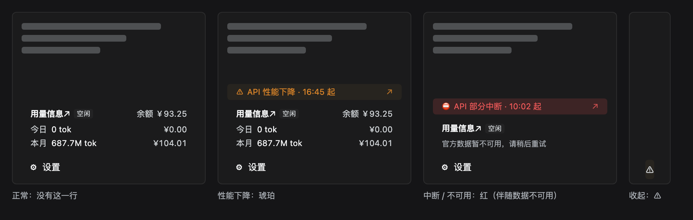

# dsh-usage-stats

[](https://en.wikipedia.org/wiki/Vibe_coding)

给用 DeepSeek Harness（DSH）写东西的人用：在侧边栏加一张**用量小卡**，随时看到今天、这个月
花了多少 token 和多少钱，以及账户还剩多少余额 —— 不用再开网页查账单。

## 它能回答什么问题

- **今天用了多少、花了多少钱？** 侧边栏左下角一眼看到；收起侧边栏也留一行简版。
- **这个月累计用了多少？** token 和费用按月累计显示，配合余额大概知道自己花到什么程度。
- **账户还剩多少钱？** 余额直接显示在卡片右侧。
- **现在是高峰还是空闲时段？** 标题旁的「高峰 / 空闲」标签（空闲价是高峰价的一半）。
- **DeepSeek 出故障了吗、DSH 有新版吗？** 只在真的有事时冒出一行提示或一个徽章，平时不占地方。

## 怎么用

**1. 安装**（web profile）

```sh
dsh plugin --profile web add ./dsh-usage-stats   # 也可以从 GitHub 装：github:hiauhong/dsh-usage-stats
```

装完重启 `dsh web`。

**2. 配置 token**（一次性；之后改文件即生效）

在 `~/.dsh/dsh-usage-stats.json` 写上：

```json
{ "platformToken": "你的 userToken" }
```

获取方式：登录 platform.deepseek.com → 按 F12 → Application → Local Storage →
`https://platform.deepseek.com` → 复制 `userToken` 的值。

**3. 看数据**：侧边栏左下角（设置按钮上方）就是卡片。点标题「用量信息↗」可跳官方用量页看明细。

## 效果预览

> 截图取自深色主题；浅色主题形态一致，只是配色相反。

带故障提示时的四种形态（正常 / 性能下降 / 中断 / 收起侧边栏），从左到右：



DSH 有新版时，左上角品牌行右侧出现「有新版」徽章：


## 已知限制 / 注意

- **数据来自官方平台，不是本地统计**：token、金额、余额全部取自 DeepSeek 开放平台，用的是你自己
  浏览器里的 userToken。插件不监听本地请求、不统计会话、不自己维护价格表。
- **看到的是账号全量**：包含你在其他客户端、其他项目里的用量；不是只有这个窗口、这个项目。
- **没有明细和趋势**：读不到按项目 / 按会话 / 按天的拆分，也没有历史曲线。要看细账，点卡片标题去官方页面。
- **要能联网**：用量走 platform.deepseek.com，故障提示走 status.deepseek.com，新版检测走 npm。
- **token 会过期**：平台明确拒绝它时，卡片会提示重新配置。但网络抖动、限流、超时只显示「暂不可用」，
  **不代表 token 失效**，平台恢复后下一次自动回来。
- **故障提示不是全量播报**：只有「未恢复 + 12 小时内 + 涉及 API」的故障才会提示，其它异常不打扰你；
  拉不到状态时什么都不显示。
- **峰谷标签只是展示**：按官方峰谷口径（工作日 9:00–12:00、14:00–18:00 为高峰；周末与法定节假日
  全天为空闲），不参与任何金额计算；节假日数据截至 2026 年，官方每年发布新安排后需更新。
- **今日与本月更新时间不同**：今日按小时桶、本月按日桶，两者可能有不同的延迟。
- **只支持 web 版 DSH**：这是 web profile 的侧边栏插件。
- 🤖 项目由 AI 协作产出（vibe coding），**未经人工逐行审查**，请自行判断能否用于生产环境。

## 给开发者

技术细节收在这一节：

- 形态：Host 侧注册 `/api/usage-stats/{query,update,status}` 三个同源路由，客户端只用 React 渲染侧边栏
  插槽，不直连官方接口（status.deepseek.com 没有 CORS 头，RSS 是唯一的机器接口）。
- 失败纪律：拿不到数据就闭嘴 —— 用量拉不到显示「暂不可用」而不是 0（瞬时失败 ≠ token 无效）；
  状态问不到 ≠ 出问题；npm 请求失败不缓存、下次重试但不报错。
- 外观：颜色一律取主题 token，跟随 DSH 的深色 / 浅色设置，切换即时生效。
- 测试：`Scripts/` 下有 DOM 各状态回归、峰谷 29 例、状态恢复滞后 10 例，以及主题对比度与告警布局的
  真机校验脚本（跑法见脚本头部注释）。

## 卸载

```sh
dsh plugin --profile web remove dsh-usage-stats
```

## License / 致谢

MIT（见 [LICENSE](LICENSE)）；架构参考
[dsh-liquid-glass-balance-card](https://github.com/SoDaZilla-zzz/dsh-liquid-glass-balance-card)。
早期本地统计逻辑曾参考 [dsh-token-stats](https://github.com/F1shn/dsh-token-stats)（MIT），现已移除。
