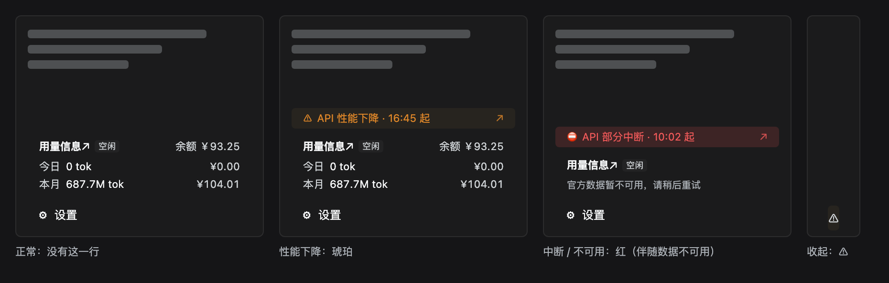
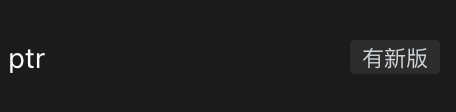
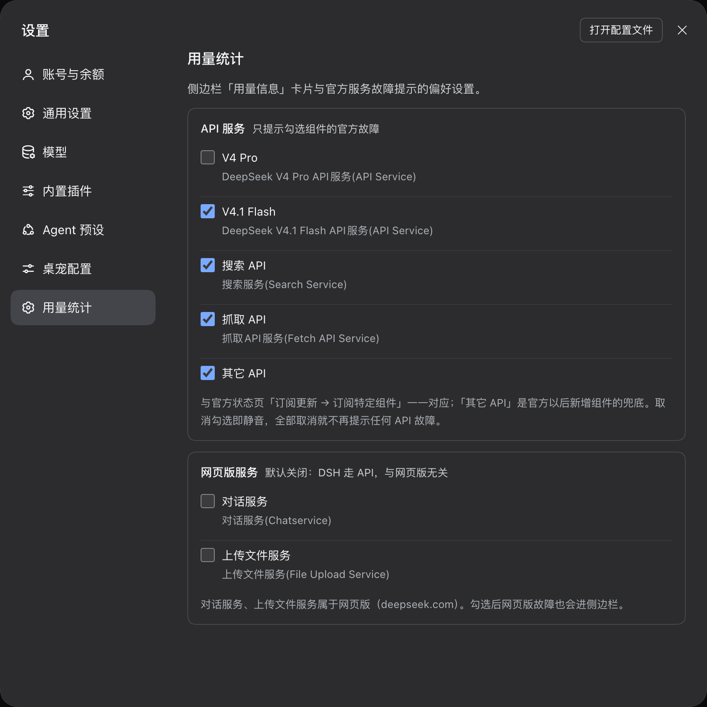

# dsh-usage-stats

[](https://en.wikipedia.org/wiki/Vibe_coding)

给用 DeepSeek Harness（DSH）写东西的人用：在侧边栏加一张**用量小卡**，随时看到今天、这个月
花了多少 token 和多少钱，以及账户还剩多少余额 —— 不用再开网页查账单。

带故障提示时的四种形态（正常 / 性能下降 / 中断 / 收起侧边栏），从左到右：



DSH 有新版时，web 版在侧边栏底部账号行右侧显示「有新版」徽章 —— 和桌面版自己的更新提示同一行
（桌面版不显示：应用会提示更新）：



> 截图取自深色主题；浅色主题形态一致，只是配色相反。

## 它能回答什么问题

- **今天用了多少、花了多少钱？** 侧边栏左下角一眼看到；收起侧边栏也留一行简版。
- **这个月累计用了多少？** token 和费用按月累计显示，配合余额大概知道自己花到什么程度。
- **账户还剩多少钱？** 余额直接显示在卡片右侧。
- **现在是高峰还是空闲时段？** 标题旁的「高峰 / 空闲」标签（空闲价是高峰价的一半）。
- **DeepSeek 出故障了吗、DSH 有新版吗？** 只在真的有事时冒出一行提示或一个徽章，平时不占地方。
  「有新版」徽章只在 web 版出现 —— 桌面应用自己带「检查更新」和更新弹窗，不再重复提示。
- **只提示我在用的组件。** 设置里可以按官方组件（Pro / Flash / 搜索 API / 抓取 API …）关掉不关心的
  告警 —— 主用 Flash 时，Pro 的故障不再打扰你。

## 怎么用

**1. 安装**（web profile；桌面版把 `--profile web` 换成 `--profile desktop`）

```sh
dsh plugin --profile web add ./dsh-usage-stats   # 也可以从 GitHub 装：github:hiauhong/dsh-usage-stats
```

装完重启 `dsh web`（桌面版则重启应用）。

**2. 配置 token**（一次性；之后改文件即生效）

在 `~/.dsh/dsh-usage-stats.json` 写上：

```json
{ "platformToken": "你的 userToken" }
```

获取方式：登录 platform.deepseek.com → 按 F12 → Application → Local Storage →
`https://platform.deepseek.com` → 复制 `userToken` 的值。

**3. 看数据**：侧边栏左下角（设置按钮上方）就是卡片。点标题「用量信息↗」可跳官方用量页看明细。

**4. 设置**（可选）：设置 → 最下面的「用量统计」。最上面是 **Token 单位**，下面按官方组件选告警。

- **Token 单位**：中文按万 / 亿（`2640万 tok`），英文按 K / M / B（`26.4M tok`）。只影响显示，
  不改任何数值；默认英文（和老版本一致）。
- **告警组件**：对应官方状态页的「订阅更新 → 订阅特定组件」：

| 分组 | 组件 |
|---|---|
| API 服务（默认开） | V4 Pro、V4.1 Flash、搜索 API、抓取 API，外加「其它 API」兜底官方以后新增的组件 |
| 网页版服务（默认关） | 对话服务、上传文件服务 |

网页版默认关闭，因为 DSH 走的是 API —— 但想收也可以勾上。取消勾选 = 静音：该组件再出故障时侧边栏
不提示，别的组件照常提示。



选择存在 `~/.dsh/dsh-usage-stats.settings.json`（与 token 文件分开，互不影响）：

```json
{ "alerts": { "muted": ["chat", "upload", "pro"] }, "display": { "tokenUnit": "zh" } }
```

手改这个文件同样生效（改完刷新页面即可）。没有这个文件时默认静音网页版（`chat` / `upload`）、
单位用英文；文件坏了会回到「全都提示」，不会把告警静默掉。

## 已知限制 / 注意

- **数据来自官方平台，不是本地统计**：token、金额、余额全部取自 DeepSeek 开放平台，用的是你自己
  浏览器里的 userToken。插件不监听本地请求、不统计会话、不自己维护价格表。
- **看到的是账号全量**：包含你在其他客户端、其他项目里的用量；不是只有这个窗口、这个项目。
- **没有明细和趋势**：读不到按项目 / 按会话 / 按天的拆分，也没有历史曲线。要看细账，点卡片标题去官方页面。
- **要能联网**：用量走 platform.deepseek.com，故障提示走 status.deepseek.com，新版检测走 npm（仅 web 版）。
- **token 会过期**：平台明确拒绝它时，卡片会提示重新配置。但网络抖动、限流、超时只显示「暂不可用」，
  **不代表 token 失效**，平台恢复后下一次自动回来。
- **故障提示不是全量播报**：只有「未恢复 + 12 小时内 + 涉及 API」的故障才会提示，其它异常不打扰你；
  被静音的组件（见上面第 4 步）同样不提示；拉不到状态时什么都不显示。判定会扫**全部**条目，
  所以更新的搜索服务异常不会盖住仍在进行中的 API 故障。
- **「有新版」只催 rc 与正式版**：alpha 是内部构建，官方下一步往往自己就弃了，不提示。「最新版」取
  npm 上 `latest` 与 `next` 的较高者 —— rc 常常只挂在 `next` 上，只看 `latest` 会漏报。桌面版不检测
  也不亮徽章（应用自己带「检查更新」），判据是桌面壳注入的 `dshDesktopBoot` 全局。
- **峰谷标签只是展示**：按官方峰谷口径（工作日 9:00–12:00、14:00–18:00 为高峰；周末与法定节假日
  全天为空闲），不参与任何金额计算；节假日数据截至 2026 年，官方每年发布新安排后需更新。
- **今日与本月更新时间不同**：今日按小时桶、本月按日桶，两者可能有不同的延迟。
- **web 版与桌面版都能装**：同一个包在两种 profile 里都能用；只有「有新版」徽章按上面说的
  在桌面版隐藏。
- 🤖 项目由 AI 协作产出（vibe coding），**未经人工逐行审查**，请自行判断能否用于生产环境。

## 给开发者

技术细节收在这一节：

- 形态：Host 侧注册 `/api/usage-stats/{query,update,status,alerts,display}` 五个同源路由，客户端只用 React
  渲染侧边栏插槽与设置页插槽，不直连官方接口（status.deepseek.com 没有 CORS 头，RSS 是唯一的机器接口）。
- 告警组件：官方可订阅组件（`COMPONENT_RULES`）映射到稳定键（`pro`/`flash`/`search`/`fetch`/`chat`/`upload`
  + 兜底 `other`），键不含版本号。`status` 路由按 `alerts` 设置过滤，静音项进缓存键（改设置 = 换一份快照）；
  `alerts` 路由 `GET` 给组件清单（标签取自官方组件名，省掉第二次抓 feed）、`POST` 整份覆盖静音项
  （原子写、未知键丢弃、坏文件回「全都提示」）。`display` 路由管 token 单位（`en` / `zh`），
  与 `alerts` 共用同一个设置文件：一次读全、原子写全，写一段不会抹掉另一段；单位只影响客户端显示，
  不进任何缓存键。
- 失败纪律：拿不到数据就闭嘴 —— 用量拉不到显示「暂不可用」而不是 0（瞬时失败 ≠ token 无效）；
  状态问不到 ≠ 出问题；npm 请求失败不缓存、下次重试但不报错。
- 外观：颜色一律取主题 token，跟随 DSH 的深色 / 浅色设置，切换即时生效；设置页与官方设置页同宽（720px）。
- 桌面版判据在客户端：桌面壳 preload 会给页面注入 `window.dshDesktopBoot`（DSH 前端用它判断要不要
  走桌面 boot），有它就整段跳过新版检测（不请求 `/update`、不装 observer、不留定时器）；web 页面
  没有这个全局，行为不变。Host 侧 `/update` 路由保持原样，浏览器打开同一个 Host 时照旧可用。
- 「有新版」的位置：挂在 `[data-slot="sidebar.settings"]` 的 triggerRow（账号行）末尾、靠右 ——
  桌面版自己的 `DesktopUpdateIndicator` 就在这一行，两个版本提示落在同一个地方。这一行是 DSH 的
  设置触发行，插件没有可注册的 slot，所以按行注入节点（`[class*="triggerRow"]`），并用
  MutationObserver 处理行晚渲染 / React 重建。收起成图标栏时那一行只有 36px（< 120px 判据），
  徽章先撤掉，展开后补回来。
- 测试：`Scripts/` 下有 DOM 各状态回归 20 例、token 单位格式化 19 例、峰谷 29 例、状态恢复滞后、
  告警组件与设置读写、路由集成 24 例，以及主题对比度与告警布局的真机校验脚本（跑法见脚本头部注释）。

## 卸载

```sh
dsh plugin --profile web remove dsh-usage-stats   # 桌面版换 --profile desktop
```

## License / 致谢

MIT（见 [LICENSE](LICENSE)）；架构参考
[dsh-liquid-glass-balance-card](https://github.com/SoDaZilla-zzz/dsh-liquid-glass-balance-card)。
早期本地统计逻辑曾参考 [dsh-token-stats](https://github.com/F1shn/dsh-token-stats)（MIT），现已移除。
